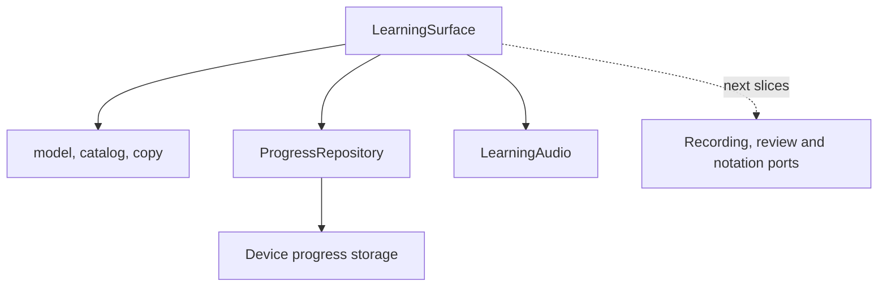

# Ultimate Exercise development

Start here to develop the student ecosystem inside `harmonic-study-engine`. The working learning app is `/learn`; the existing engine remains `/`. The learning prototype and this development foundation are on `feature/ultimate-exercise-ecosystem`, proposed in draft PR #8. “Implemented” below means present on that branch, not released to production.

## Get running

Use Node 22, matching CI and `.nvmrc`. `nvm` is optional; any Node manager that provides Node 22 is sufficient.

```sh
nvm use                 # if nvm is installed
npm ci
npm run dev:learn       # opens http://localhost:5173/learn
```

The learning app needs no Python backend, API key, cloud account, microphone or paid service. `npm run dev` starts the broader optional frontend/backend workflow; it is not required for `/learn`.

| Command                     | Use                                                                                  |
| --------------------------- | ------------------------------------------------------------------------------------ |
| `npm run dev:learn`         | Start the frontend on loopback and open the learning route                           |
| `npm run test:learning`     | Fast curriculum, backup and storage-boundary unit tests                              |
| `npm run check:docs`        | Check the repository's existing documentation drift gate                             |
| `npm run lint`              | Full TypeScript check                                                                |
| `npm test`                  | Full frontend unit suite                                                             |
| `npm run build`             | Both existing production builds, including the RNN build                             |
| `npm run test:e2e:learning` | Learning workflows and the existing `/play` route checks against built `dist/`       |
| `npm run verify:learning`   | Documentation gate → types → full unit suite → both builds → learning browser checks |
| `npm run test:e2e`          | Full existing browser suite; run for shared engine/UI changes                        |

Install Chromium once with `npm run e2e:install`. Browser tests require a completed build. `verify:learning` includes that build; `test:e2e:learning` alone does not. Existing GitHub workflows continue running the complete frontend, backend and browser gates; the focused command is an additional development loop, not a replacement for CI.

## Module boundaries



| Area               | Source                                          | Rule                                                                                                    |
| ------------------ | ----------------------------------------------- | ------------------------------------------------------------------------------------------------------- |
| Musical data       | `src/learning/model.ts`, `catalog.ts`           | Store sounding MIDI and beat positions; UI language must not change music                               |
| Translations       | `src/learning/copy.ts` and lesson `Copy` values | Keep English and Serbian content complete; preserve current work on language change                     |
| Progress           | `src/learning/persistence.ts`                   | Inject storage; report unavailable/quota errors; validate backups before replacing work                 |
| Reference playback | `src/learning/audio.ts`                         | Start from a learner action; stop and release resources on navigation/unmount                           |
| Student UI         | `src/learning/LearningSurface.tsx`              | Coordinate features; move persistence/audio/analysis logic into separate adapters                       |
| Next integrations  | `src/learning/ports.ts`                         | Type-only contracts for recorder, take repository, review and notation; no placeholder runtime services |
| Existing engine    | `src/lib/` and `src/components/`                | Reuse through explicit adapters; avoid copying singleton engines into the learning UI                   |

The screen uses the real progress repository now. Recording, IndexedDB takes, automated review and direct lesson notation are contracts and backlog items; they are not wired features. Do not add controls that claim these features work before their adapter and end-to-end path exist.

## Build the next slice

Start with **UE-10: local recording** in [the development backlog](ULTIMATE-EXERCISE-BACKLOG.md). Build one complete path: user starts recording → stops → hears their take → reopens it after reload. Keep the first rhythm activities permission-free.

1. Implement `RecorderPort` as a browser adapter. Capability detection must not request permission. Make `start` gesture-driven and abortable; make `stop` return final bytes and `cancel` release tracks.
2. Implement `TakeRepositoryPort` with IndexedDB. Store blobs separately from the small progress JSON. List metadata in bounded pages. Handle deletion, quota exhaustion and failed writes.
3. Mount a dedicated recording component from the practice room. Keep recording state and stop/cancel visible. Do not start analysis or a backend upload implicitly.
4. Add fixtures and tests for permission denial, unsupported formats, interrupted capture, successful replay, reload, duplicate stop and deletion. Run the full gates before committing.
5. Validate on an actual Android phone and iPhone. Record device/browser, what was tested and what remains unverified.

### Existing code to inspect before adapting

| Existing module               | Useful capability                                           | Integration constraint                                                                                                     |
| ----------------------------- | ----------------------------------------------------------- | -------------------------------------------------------------------------------------------------------------------------- |
| `src/lib/audioRecorder.ts`    | MediaRecorder lifecycle, combined engine/mic capture        | Coupled to the engine master bus, WebM/video assumptions and optional backend workflow; not a drop-in local music recorder |
| `src/lib/recorder.ts`         | Engine MIDI note-event capture                              | Not microphone audio; clarify time units before mapping to performed notes                                                 |
| `src/lib/tunerCapture.ts`     | Shared microphone capture, capability and permission errors | Shared capture lifecycle; do not open a second conflicting mic graph by accident                                           |
| `src/lib/trumpetTuner.ts`     | Pitch detection helpers                                     | Retain confidence/silence handling; never treat uncertain input as a wrong note                                            |
| `src/lib/scoreExport.ts`      | MusicXML export                                             | Existing harmonic-path representation needs an adapter for lesson melody events                                            |
| `src/lib/sheetMusicExport.ts` | Browser notation/PDF rendering                              | Confirm staff, rhythm, written transposition and concert playback with real notation imports                               |

Capture duration and performed-note times use **seconds**. Lesson reference positions use **beats**. Preserve original timing when producing a quantized score. Keep `inputLatencySeconds: null` when uncalibrated. Store sounding pitches; apply +2 semitones only when displaying/exporting a B♭ part. Each lesson now has an explicit `revision` (the seed lessons start at `"1"`); bump it when reference music or targets change. Keep that revision and analyzer version with take/review data so comparisons can be explained.

## Change and review workflow

- Use small feature branches and draft PRs. A public production release or merge needs a separate explicit decision.
- Add one usable vertical slice per PR with its acceptance checklist. Use the optional [learning PR template](../.github/PULL_REQUEST_TEMPLATE/learning.md) or [learning task template](../.github/ISSUE_TEMPLATE/learning-slice.yml).
- Add pure logic tests under the normal Vitest node project. If a DOM test is needed, follow the repository's `JSDOM_FILES` requirement. Keep the documentation count pins current when adding `tests/*.test.ts` cases.
- Run `npm run verify:learning`; shared engine changes also need `npm run test:e2e`. Keep all CI checks enabled. Fix failing assertions against the shipped product contract rather than changing product behavior just to satisfy stale tests.
- Distinguish fixture-based checks, browser emulation and real device checks in the PR. A playback-state assertion does not validate acoustic quality.
- Keep lesson audio/video provenance and captions with the content. The [footage plan](ULTIMATE-EXERCISE-FOOTAGE.md) defines the first shooting batch.

Stay within the existing KAI SWARM limits: at most two concurrent agents and a US$2/day external API budget. This foundation uses no paid APIs or background agents. Accounts, teacher payments, competition and public sharing remain outside the local pilot.
